# Kin, laptop edition — architecture spec

System architecture · Laptop demo build · Python over C++

The same companion as the phone design, rebuilt for a first demo on a laptop. Python handles orchestration, storage and the UI. Every heavy step (audio I/O, voice detection, speech recognition, embeddings, the language model, encryption) runs inside compiled C/C++ engines that Python calls. The models, database schema, prompts and grammars are the exact files the phone app will load later.

---

## 0. Instructions for Claude Code (read first, follow every time)

1. **This file is the source of truth.** Do not add, rename, merge or drop components or data flows. If something here looks wrong or impossible, stop and ask. Do not quietly work around it.
2. **Everything has an ID.** Hardware `HW*`, audio `A*`, perception `P*`, context `C*`, memory `M*`, reasoning `R*`, outputs `O*`, gateway `G*`, external `X*`, edges (data flows) `E**`, flows `F*`, invariants `INV*`, clarifications `CL*`.
3. **Work one week at a time.** Section 12 lists exactly which IDs belong to each week. Build only those IDs, and build all of them.
4. **Plan before coding.** At the start of a week, print a table of every component ID and edge ID in scope, with the file you will create or change for each. Wait for my OK.
5. **Definition of done.** Every in-scope component and edge must have at least one test named `test_<id>_<what>` (e.g. `test_E10_speech_event_has_mode_flag`). At the end of the week, print the same table with a test name and PASS/FAIL for each ID. A week is done only when every row passes.
6. **Invariants (section 1.7) are never optional.** Each one has a test, and those tests run in every week from the week they appear.
7. **Ask before:** any `sudo` or admin command, any model or package download, any change to `spec/`, and any new dependency not listed in Sheet 10.
8. **Never commit** secrets, `.env`, model files, databases or audio files.

---

## Title block

| Field | Value |
|---|---|
| Focus | Memory & recall (primary) · Productivity (secondary) |
| Demo host | Windows 11, macOS or Ubuntu laptop, 8–16 GB RAM |
| Accessory | Clip: USB mic, hardware mute switch, LEDs |
| Runtime | Python 3.11, uv-managed, CPU-only wheels, **no PyTorch, no transformers** |
| Profile | `KIN_PROFILE=phone` caps threads and RAM to phone limits (demo runs in this profile) |

| Budget target | Value |
|---|---|
| Install size | ≈ 1.2 GB (≈ 300 MB Python env + ≈ 0.85 GB models) |
| RAM while listening (all processes) | ≈ 300 MB |
| RAM peak while thinking | ≤ 1.3 GB, mostly mmap |
| Average CPU while idle-listening | < 2 % |

---

# Sheet 1 — System, end to end

The tiers and the online boundary are unchanged from the phone design. What changes is how the parts run: four operating-system processes instead of one Android app. Audio capture can never be starved by the model, and the reasoning process is started with networking switched off at the OS level.

Work escalates through three tiers. Each tier wakes only when the one before it has a reason:
- **T0 (always on):** mic capture, energy gate, voice activity detection, wake word.
- **T1 (only when someone speaks):** speech to text, speaker tag, filters, episodes.
- **T2 (only when there is a question or task):** router, retrieval, language model, tools, confidence gate.

## 1.1 Zones and processes

| Zone / process | Contains (IDs) | Network access |
|---|---|---|
| Hardware (clip + laptop) | HW1–HW7 | — |
| `kin-audio` process | A1–A6 | **NONE** |
| `kin-core` process | C1, P1–P5, M1–M3, R1–R6, O1 (status logic), O3 (voice) | **NONE** (kernel-enforced on Linux) |
| `kin-gateway` process | G1 | **ALLOWLIST ONLY:** 3 hosts |
| `kin-ui` process | O2, O4 | **LOOPBACK ONLY** (127.0.0.1) |
| Public internet | X1–X3 | reachable only from G1 |

**The device boundary:** everything except X1–X3 runs on the laptop and clip. Every inference and every decision happens inside it.
**The online boundary:** only G1 may cross it, and only with a typed `FactRequest` (Sheet 4).

## 1.2 Diagram (Mermaid)

Solid arrows are local data flows. Dotted arrows cross the online boundary. Edge labels start with their edge ID from section 1.4.

```mermaid
flowchart LR
  subgraph DEVICE["ON THE LAPTOP + CLIP - every inference and decision happens here"]
    direction LR

    subgraph HW["HARDWARE - clip + laptop"]
      direction TB
      HW1["HW1 Clip mic MEMS<br/>ESP32-S3 USB audio"]
      HW2["HW2 Mute slide switch<br/>cuts mic power in HW"]
      HW3["HW3 Listening LED<br/>on mic power rail"]
      HW4["HW4 Laptop mic<br/>fallback"]
      HW5["HW5 Laptop signals<br/>AC power, idle, clock"]
      HW6["HW6 Local data read-only<br/>calendar .ics, contacts"]
      HW7["HW7 Clip status RGB LED"]
    end

    subgraph AUD["kin-audio process - T0 - NO NETWORK"]
      direction TB
      A1["A1 Mic capture<br/>sounddevice, 16 kHz mono"]
      A2["A2 Shared-memory ring 30 s<br/>never on disk"]
      A3["A3 Energy gate<br/>RMS over floor + 6 dB"]
      A4["A4 Silero VAD<br/>onnxruntime"]
      A5["A5 Wake word<br/>openWakeWord, ungated"]
      A6["A6 Clip serial link<br/>pyserial"]
    end

    subgraph CORE["kin-core process - NO NETWORK"]
      direction LR
      subgraph PER["PERCEPTION - T1"]
        direction TB
        P1["P1 Speech to text<br/>sherpa-onnx Moonshine"]
        P2["P2 Speaker tag<br/>you vs other"]
        P3["P3 Sensitive filter<br/>OTP, card, PIN"]
        P4["P4 Segmenter<br/>60 s episodes"]
        P5["P5 Signal extractor<br/>rules + dateparser"]
      end
      C1["C1 Context fusion<br/>AC, idle, meeting"]
      subgraph MEM["MEMORY"]
        direction TB
        M1["M1 Embedder<br/>fastembed MiniLM int8"]
        M2[("M2 Encrypted memory<br/>SQLCipher + sqlite-vec + FTS5<br/>episodes, facts, tasks, people,<br/>vectors, digests, egress_log")]
        M3["M3 Consolidator<br/>nightly, on AC, idle"]
      end
      subgraph RSN["REASONING - T2"]
        direction TB
        R1["R1 Intent router<br/>numpy centroids"]
        R2["R2 Context builder<br/>FTS5 + vector + .ics"]
        R3["R3 Local LLM<br/>llama-cpp-python<br/>Gemma 3 1B Q4, mmap"]
        R4["R4 Tool executor<br/>GBNF grammar to pydantic"]
        R5["R5 Confidence gate<br/>grounded + cited"]
        R6["R6 Proactive scheduler<br/>asyncio"]
      end
      O1["O1 Status controller<br/>LED patterns + earcons"]
      O3["O3 Voice reply<br/>Piper TTS local"]
    end

    subgraph GWP["kin-gateway process - ONLY PROCESS ONLINE"]
      G1["G1 Fact Gateway<br/>httpx, allowlist 3 hosts<br/>pydantic, PII scrub"]
    end

    subgraph UIP["kin-ui process - 127.0.0.1 only"]
      O4["O4 Companion UI<br/>FastAPI + WebSocket"]
      O2["O2 Egress ledger view"]
    end
  end

  subgraph NET["PUBLIC INTERNET - facts only, never reasoning"]
    X1["X1 Open-Meteo<br/>weather, no key"]
    X2["X2 Search API<br/>Brave or SearXNG"]
    X3["X3 News RSS<br/>allowlisted feeds"]
    XF["NEVER CROSSES:<br/>prompts to cloud LLMs, raw audio,<br/>transcripts, memories, telemetry"]
  end

  HW1 -- "E01 PCM over USB" --> A1
  HW2 -- "E02 mic power" --> HW1
  HW2 -- "E03 same power rail" --> HW3
  HW4 -- "E04 fallback mic" --> A1
  HW2 -- "E05 mute state GPIO" --> A6
  A1 -- "E06 80 ms blocks" --> A2
  A2 -- "E07 frames" --> A3
  A2 -- "E41 every 80 ms chunk, ungated" --> A5
  A3 -- "E08 only if loud" --> A4
  A4 -- "E09 speech end (closes command window)" --> A5
  A5 -- "E10 SpeechEvent + mode flag" --> P1
  P1 -- "E11 text" --> P2
  P2 -- "E12 speaker-tagged" --> P3
  P3 -- "E13 clean text" --> P4
  P4 -- "E14 episode" --> P5
  P4 -- "E15 episode text" --> M1
  M1 -- "E16 vectors" --> M2
  P5 -- "E17 candidates" --> M2
  M3 -- "E18 summarise, decay" --> M2
  P1 -- "E19 command utterance" --> R1
  R1 -- "E20 intent" --> R2
  M2 -- "E21 top-k" --> R2
  R2 -- "E22 prompt max 1k tokens" --> R3
  R3 -- "E23 tool call and result" --> R4
  R4 -- "E24 writes" --> M2
  R4 -. "E25 fact.lookup FactRequest" .-> G1
  G1 -. "E26 LedgerEntry" .-> O2
  G1 -. "E27 max 2 KB query" .-> X1
  G1 -. "E27" .-> X2
  G1 -. "E27" .-> X3
  R4 -- "E28 draft + sources" --> R5
  R5 -- "E29 answer" --> O3
  R5 -- "E30 answer" --> O4
  C1 -- "E31 context events, no audio" --> R6
  HW5 -- "E32 events" --> C1
  HW6 -- "E33 calendar" --> C1
  HW6 -- "E34 calendar entries" --> R2
  R6 -- "E35 proactive trigger" --> R1
  P1 -- "E36 live transcript" --> O4
  O1 -- "E37 LED patterns" --> A6
  A6 -- "E37" --> HW7
  O4 -- "E38 user actions" --> M2
```



## 1.3 Component register

| ID | Component | Process | Technology (package → engine) | Input | Output | Week |
|---|---|---|---|---|---|---|
| HW1 | Clip mic | hardware | INMP441 I²S MEMS on ESP32-S3, USB Audio Class | sound | 16 kHz PCM over USB | W4 |
| HW2 | Mute slide switch | hardware | SPDT switch + P-MOSFET on mic power | hand | mic power on/off; mute GPIO | W4 |
| HW3 | Listening LED (green) | hardware | on the mic power rail | mic power | light on **only** when mic has power | W4 |
| HW4 | Laptop mic (fallback) | hardware | built-in mic, OS mute toggle | sound | PCM | W1 |
| HW5 | Laptop signals | OS | `psutil` (AC, battery, idle), clock | — | raw signals | W2 |
| HW6 | Local data (read-only) | files | `.ics` calendar, contacts file | — | records | W3 |
| HW7 | Clip status RGB LED | hardware | driven by firmware from serial commands | LED command | light pattern | W4 |
| A1 | Mic capture | kin-audio | `sounddevice` → PortAudio; 16 kHz, mono, int16, 80 ms blocks (1,280 samples) | PCM | blocks → A2 | W1 |
| A2 | Ring buffer, 30 s | kin-audio | `multiprocessing.shared_memory` + `numpy` | frames | frames | W1 |
| A3 | Energy gate | kin-audio | `numpy` RMS vs rolling noise floor + 6 dB | frames | loud frames only | W1 |
| A4 | Voice activity | kin-audio | Silero VAD v5 via `onnxruntime`, 512-sample windows cut from the 1,280-sample blocks with a carry-over buffer | loud frames | speech start/end | W1 |
| A5 | Wake word | kin-audio | `openwakeword` (ONNX mode); "hey jarvis" stand-in until "Hey Kin" is trained. Scores **every** 80 ms chunk, in parallel with A3/A4 (never gated). Triggers when the score is ≥ threshold (default 0.5, `--wake-threshold`) for 2 consecutive chunks; SpeexDSP noise suppression where `speexdsp_ns` is installed | every chunk (E41) + speech end (E09) | mode = `ambient` or `command`; on trigger the current segment is cut where the phrase starts and a command window opens (up to 1.5 s of silence after the wake word, capped 8 s after it, ended by VAD end of speech) | W1 |
| A6 | Clip serial link | kin-audio | `pyserial` | mute GPIO state; LED commands | `MuteState`; bytes to HW7 | W4 |
| C1 | Context fusion | kin-core | `psutil` + `icalendar`, 30 s timer | HW5, HW6 | `ContextEvent` | W2 (AC/idle), W3 (meetings) |
| P1 | Speech to text | kin-core | `sherpa-onnx` → Moonshine Tiny int8 | audio slice from A2 | `Transcript` | W1 |
| P2 | Speaker tag | kin-core | `sherpa-onnx` speaker embedding; owner enrolled once | transcript + audio slice | speaker = `you` / `other` | W2 |
| P3 | Sensitive filter | kin-core | regex: OTPs, card numbers, PINs | text | redacted text | W2 |
| P4 | Segmenter | kin-core | groups utterances into ~60 s episodes | utterances | `Episode` | W2 |
| P5 | Signal extractor | kin-core | rules + `dateparser` | episode | `TaskCandidate`, people mentions | W2 |
| M1 | Embedder | kin-core | `fastembed` → all-MiniLM-L6-v2 int8, 384-d | text | vector | W2 |
| M2 | Encrypted memory | kin-core | `sqlcipher3` + `sqlite-vec` + FTS5; key in `keyring` | writes | reads, top-k | W2 (`egress_log` in W4) |
| M3 | Consolidator | kin-core | nightly, only on AC + 20 min idle | M2 | digests, merged facts, expiry | W2 (expiry), W3 (digests via R3) |
| R1 | Intent router | kin-core | `numpy` nearest-centroid on M1 embeddings; labels = Sheet 6 intents | utterance | `Intent` | W3 |
| R2 | Context builder | kin-core | FTS5 + vector top-k, plus calendar | intent + utterance | prompt context | W3 |
| R3 | Local LLM | kin-core | `llama-cpp-python` → llama.cpp; Gemma 3 1B Q4 GGUF, `use_mmap=True`, 2k context, unload after 60 s idle | prompt | draft / tool call | W3 |
| R4 | Tool executor | kin-core | GBNF grammar → JSON → `pydantic` validation | tool call | tool result | W3 |
| R5 | Confidence gate | kin-core | checks citations exist and contain the claim; abstains below threshold | draft + sources | `Answer` or honest decline | W3 |
| R6 | Proactive scheduler | kin-core | `asyncio` timers: due tasks, reminders, context triggers | tasks, `ContextEvent` | trigger → R1 | W3 |
| O1 | Status controller | kin-core | state machine → LED pattern + earcon | state changes | `StatusEvent` | W1 (on screen), W4 (clip LED) |
| O3 | Voice reply | kin-core | `piper-tts` → Piper on ONNX Runtime (fallback `pyttsx3`) | `Answer` | speech | W4 (W3 prints text) |
| G1 | Fact Gateway | kin-gateway | `httpx` + `pydantic`; allowlist, PII scrub, 2 KB / 16 KB caps, 3 s timeout, 15 min cache | `FactRequest` | `FactResponse` + `LedgerEntry` | W4 (W3: offline stub) |
| O2 | Egress ledger view | kin-ui | page listing every online call with exact payload | `LedgerEntry` | UI | W4 |
| O4 | Companion UI | kin-ui | `fastapi` + `uvicorn` on 127.0.0.1 + WebSocket; per-session token | events | transcript, timeline, tasks, mute state | W1 (transcript), W2 (timeline), W3 (answers) |
| X1 | Open-Meteo | internet | weather, no API key | — | — | W4 |
| X2 | Search API | internet | Brave Search API or self-hosted SearXNG | — | — | W4 |
| X3 | News feeds | internet | allowlisted RSS feeds | — | — | W4 |

**M2 tables:** `episodes` (text, time, place, speaker), `facts` (subject, claim, source episode ids), `tasks` (what, due, status, source), `people` (name, aliases), `vectors` (int8, 384-d, episode id), `digests` (daily summaries), `egress_log` (every online call).

## 1.4 Edge register (every arrow)

| Edge | From → To | Carries | When | Transport | Week |
|---|---|---|---|---|---|
| E01 | HW1 → A1 | 16 kHz PCM | continuous while powered | USB Audio Class device | W4 |
| E02 | HW2 → HW1 | mic power | switch position | wire (hardware) | W4 |
| E03 | HW2 → HW3 | same power rail | switch position | wire (hardware) | W4 |
| E04 | HW4 → A1 | PCM | when clip absent | PortAudio device | W1 |
| E05 | HW2 → A6 | mute state (from Sheet 7) | on change | GPIO → firmware → USB serial | W4 |
| E06 | A1 → A2 | 80 ms blocks (1,280 samples) | every 80 ms | copy in audio callback | W1 |
| E07 | A2 → A3 | frames | every frame | in-process | W1 |
| E08 | A3 → A4 | frames | **only if** RMS > floor + 6 dB | in-process | W1 |
| E09 | A4 → A5 | speech start/end | per VAD transition | in-process; closes the command window. **No longer gates A5** | W1 |
| E41 | A2 → A5 | every 80 ms chunk, ungated | every 80 ms | in-process; the wake word sees all audio, silence included | W1 |
| E10 | A5 → P1 | `SpeechEvent` (ring offsets + mode flag) | per speech segment | shared memory + `multiprocessing` queue | W1 |
| E11 | P1 → P2 | transcript text | per segment | in-process | W2 |
| E12 | P2 → P3 | speaker-tagged text | per segment | in-process | W2 |
| E13 | P3 → P4 | redacted text | per segment | in-process | W2 |
| E14 | P4 → P5 | `Episode` | per closed episode | in-process | W2 |
| E15 | P4 → M1 | episode text | per closed episode | in-process | W2 |
| E16 | M1 → M2 | vector | per episode | SQL insert | W2 |
| E17 | P5 → M2 | `TaskCandidate`, people mentions | when found | SQL insert | W2 |
| E18 | M3 ⇄ M2 | digests, merged facts, deletions of expired rows | nightly | SQL | W2/W3 |
| E19 | P1 → R1 | command utterance | **only when** mode = `command` | in-process | W3 |
| E20 | R1 → R2 | `Intent` | per command | in-process | W3 |
| E21 | M2 → R2 | top-k episodes, facts, tasks | per command | SQL (FTS5 + vector) | W3 |
| E22 | R2 → R3 | prompt, max ~1k tokens | per command | in-process | W3 |
| E23 | R3 ⇄ R4 | grammar-constrained tool call ⇄ result | as needed | in-process | W3 |
| E24 | R4 → M2 | task/reminder writes, confirmations | on tool call | SQL | W3 |
| E25 | R4 → G1 | `FactRequest` | on `fact.lookup` tool call | local IPC (see CL2) | W4 (W3 stub) |
| E26 | G1 → O2 | `LedgerEntry` (returned with every response; kin-core stores it in `M2.egress_log`, UI shows it) | every online call | local IPC | W4 |
| E27 | G1 ⇄ X1/X2/X3 | HTTPS request ≤ 2 KB, response ≤ 16 KB | per `FactRequest` | HTTPS, allowlisted hosts only | W4 |
| E28 | R4 → R5 | draft answer + source ids | per command | in-process | W3 |
| E29 | R5 → O3 | `Answer` (voice text, ≤ ~120 tokens) | per command | in-process | W4 |
| E30 | R5 → O4 | `Answer` (full, with citations) | per command | local IPC → WebSocket | W3 |
| E31 | C1 → R6 | `ContextEvent` (never audio) | on change | in-process | W3 |
| E32 | HW5 → C1 | AC, battery, idle, time | every 30 s | `psutil` | W2 |
| E33 | HW6 → C1 | calendar (meeting now?) | every 30 s | file read | W3 |
| E34 | HW6 → R2 | calendar entries for context | per command | file read | W3 |
| E35 | R6 → R1 | proactive trigger (due task, reminder) | on timer | in-process | W3 |
| E36 | P1 → O4 | live transcript line | per segment | local IPC → WebSocket | W1 |
| E37 | O1 → A6 → HW7 | LED pattern commands; earcons play locally | on state change | local IPC → serial | W1 (screen), W4 (LED) |
| E38 | O4 → M2 | user actions: confirm task, delete episode, "forget last N minutes", wipe | on click/voice | local IPC → kin-core → SQL | W2 |

## 1.5 Message contracts

Put these in `kin/contracts.py` (pydantic, `frozen=True`). Every edge that crosses a process uses one of them.

```python
class SpeechEvent(BaseModel):      # E10  kin-audio -> kin-core
    seq: int
    start_offset: int              # sample index in the shared ring
    end_offset: int
    mode: Literal["ambient", "command"]
    t_start: float                 # unix time
    t_end: float

class Transcript(BaseModel):       # E11, E36
    seq: int
    text: str
    confidence: float
    speaker: Literal["you", "other", "kin", "unknown"] = "unknown"
    t_start: float
    t_end: float

class Episode(BaseModel):          # E14, E15
    id: str                        # "e-<int>"
    text: str
    t_start: float
    t_end: float
    place: str | None              # manual label from the UI
    speakers: list[str]

class TaskCandidate(BaseModel):    # E17
    what: str
    due: datetime | None
    source_episode: str
    confirmed: bool = False

class ContextEvent(BaseModel):     # E31
    on_ac: bool
    battery_pct: int | None
    idle_s: int
    in_meeting: bool

class Intent(BaseModel):           # E20
    label: str                     # one of the Sheet 6 intents
    score: float
    runner_up: str | None
    runner_up_score: float | None

class FactRequest(BaseModel):      # E25 (Sheet 4)
    kind: Literal["weather", "search", "news"]
    lat: float | None = None       # rounded to 0.1 degree
    lon: float | None = None
    hours: conint(ge=0, le=48) = 24
    q: constr(max_length=80) | None = None      # PII-scrubbed
    topic: Literal["local", "tech", "business", "sport"] | None = None

class FactResponse(BaseModel):     # E25 reply
    ok: bool
    kind: str
    data: dict                     # fixed structs: weather fields, 5 headlines, 5 snippets
    error: Literal["offline", "timeout", "rejected", None] = None
    ledger: "LedgerEntry"

class LedgerEntry(BaseModel):      # E26
    ts: float
    host: str
    payload: str                   # exact bytes sent, as text
    bytes_out: int
    bytes_in: int
    status: str

class Answer(BaseModel):           # E29, E30
    text: str
    voice_text: str
    citations: list[str]           # episode ids / "forecast"
    abstained: bool

class StatusEvent(BaseModel):      # E37
    state: Literal["muted", "listening", "capturing", "thinking", "fetching", "error"]

class MuteState(BaseModel):        # E05
    muted: bool
    source: Literal["clip", "os", "ui"]
```

## 1.6 End-to-end flows (implement and test each as one integration test)

**F1 — Ambient memory, no wake word** (W2)
1. E04 (or E01) → A1 captures audio.
2. E06 → A2 → E07 → A3. Quiet frames stop here.
3. E08 → A4. Non-speech stops here. In parallel, E41 → A5 scores every chunk.
4. A5 finds no wake word → mode = `ambient`; E09 (VAD speech end) closes the segment.
5. E10 → P1 transcribes (batched) → E36 shows the line in O4.
6. E11 → P2 → E12 → P3 → E13 → P4 closes a ~60 s episode.
7. E14 → P5 (task candidates → E17 → M2) and E15 → M1 → E16 → M2.
8. Nothing crosses the online boundary. O1 state = `listening`/`capturing`.

**F2 — Command answered fully offline** (W3)
1. Steps 1–4 of F1, but A5 detects the wake word (2 chunks ≥ threshold) → the segment is cut at the phrase, the rest is mode = `command` until VAD speech end (≤ 1.5 s pause after the wake word, ≤ 8 s). O1 → `capturing`, earcon plays. Safety net: if P1's transcript starts with "hey jarvis" or "jarvis" while mode = `ambient`, it is rerouted as a command and `wake_miss` is logged.
2. E10 → P1 → E19 → R1 classifies.
3. If the intent is rule-based (`task.*`, `reminder.set`, `digest.today`): R4 runs it directly, skips R3 → E24 → E28 → R5.
4. Otherwise E20 → R2; E21 top-k from M2; E34 calendar → E22 → R3 (O1 → `thinking`).
5. E23 tool calls if needed → E28 → R5 checks citations.
6. E30 → O4 shows the full answer; E29 → O3 speaks.

**F3 — Command with an online lookup (the demo)** (W4)
"Hey Kin, should I take an umbrella to the site visit Rohan mentioned?"
1. 0 ms: A5 wake word → E10 (mode = `command`). O1 → `capturing`; earcon.
2. +700 ms: P1 transcribes → E19 → R1. Top two intents are close (`recall.query`, `fact.weather`) → escalate to R3.
3. +900 ms: E20 → R2 retrieves the Rohan episode (E21) and the Thursday calendar entry (E34).
4. +1,600 ms: E22 → R3 emits, under the GBNF grammar, `{"kind":"weather","lat":21.0,"lon":79.0,"hours":48}`. **No question text, no names, no transcript.**
5. +1,650 ms: E23 → R4 → E25 → G1. O1 → `fetching` (amber blink). G1 → E27 → X1. G1 returns `FactResponse` + `LedgerEntry` → E26 → O2 shows the exact payload and bytes out.
6. +2,100 ms: R3 combines memory + forecast → E28 → R5 checks citation `#e-4182` → E29 O3 speaks, E30 O4 shows.

**F4 — Mute** (W4; the UI part in W1 via OS mute)
1. User slides HW2 → E02 cuts HW1 power → E03 turns HW3 off, in hardware.
2. E05 → A6 → `MuteState(muted=True, source="clip")` → kin-core → O1 → `muted` → O4 shows "Muted, nothing is being heard."
3. A1 receives no audio (or a device error) and does nothing else. No component may try to re-enable the mic.

**F5 — No network** (W4)
1. As F3 until E25.
2. G1 times out (3 s) or has no route → `FactResponse(ok=False, error="offline")` + `LedgerEntry(status="failed")`.
3. R3 answers the local part. R5 passes it. The voice reply says plainly that it cannot check the fact right now.

**F6 — Proactive reminder** (W3)
1. R6 timer fires for a due task or reminder (or C1 → E31 context change, e.g. meeting ended).
2. E35 → R1 → the normal F2 path → O3/O4 deliver the reminder.

**F7 — Nightly consolidation** (W2 expiry, W3 digests)
1. E32 → C1 reports `on_ac=True`, `idle_s ≥ 1200`, at night → E31 → R6 schedules M3.
2. M3 → E18: deletes transcripts older than 7 days, writes the daily digest (via R3), merges duplicate facts with source links.

**F8 — User deletes memory** (W2)
1. User clicks delete or says "forget the last 10 minutes" → E38 → kin-core hard-deletes the episode text, vectors and derived candidates from M2.
2. A test confirms the rows and vectors are gone.

## 1.7 Invariants (each needs a test from the week it appears)

| ID | Invariant | Test idea | From |
|---|---|---|---|
| INV1 | Raw audio is never written to disk or sent anywhere | scan for file writes in `kin/audio` and `kin/perception`; run a session and assert no new `.wav/.pcm/.raw` files | W1 |
| INV2 | The A2 ring is zeroed after each segment is decoded | read the ring slice after P1 finishes; assert all zeros | W1 |
| INV3 | kin-audio and kin-core cannot open network sockets | inside each, try `socket.create_connection(("1.1.1.1", 443))` → must raise | W1 (guard), W4 (namespace/firewall) |
| INV4 | Only `kin.gateway` imports `httpx`, `requests`, `urllib`, `socket`-level networking | `import-linter` contract in CI | W1 |
| INV5 | No cloud LLM SDK is installed | assert `openai`, `anthropic`, `google-generativeai` etc. are absent from `uv.lock` | W1 |
| INV6 | M2 is encrypted | opening `kin.db` with plain `sqlite3` fails with "file is not a database" | W2 |
| INV7 | Only a valid `FactRequest` leaves, to an allowlisted host, ≤ 2 KB | send invalid kinds, long `q`, names, other hosts → all rejected | W4 |
| INV8 | Every online call is in `egress_log` and O2 | count gateway calls = count ledger rows | W4 |
| INV9 | UI listens only on 127.0.0.1 and needs the session token | connect from a non-loopback address / no token → refused | W1 |
| INV10 | `HF_HUB_OFFLINE=1` and `DO_NOT_TRACK=1` are set for every process; models load from local paths only | supervisor env check | W1 |

**Never crosses the online boundary (XF):** prompts to cloud LLMs · raw audio · transcripts or memories · library telemetry.

## 1.8 Clarifications (the drawing is ambiguous here; follow these)

- **CL1 — Context fusion (C1)** is drawn in the T0 column, but it runs in **kin-core** as a light timer thread. kin-audio stays audio-only.
- **CL2 — Local IPC** uses `multiprocessing.connection` everywhere: an `AF_UNIX` socket path on Linux/macOS, a named pipe (`\\.\pipe\kin-gateway`, `\\.\pipe\kin-ui`) on Windows. The kin-core socket guard blocks only `AF_INET`/`AF_INET6`, so local IPC keeps working. Unix sockets on the filesystem also work across the Linux network namespace.
- **CL3 — The ledger** has one source of truth: `M2.egress_log`, written by kin-core from the `LedgerEntry` that G1 returns with every response (including failures). O2 reads it through kin-core.
- **CL4 — Weeks 1–3 use HW4** (laptop mic). HW1/HW2/HW3/HW7 arrive in Week 4, and A1 selects the clip by device name when present.
- **CL5 — Until Week 4, G1 is a stub** inside kin-core that always returns `FactResponse(ok=False, error="offline")`. It has no network code.
- **CL6 — Voice reply (O3)** runs in kin-core, never in kin-gateway.
- **CL7 — Router labels** are exactly the intents in the Sheet 6 table (plus any added in section 11). The "8 intents" in the old drawing was approximate.
- **CL8 — Supervisor** (`kin run`) starts all four processes, restarts any that crash within 2 s, and applies the network isolation from Sheet 4 when starting kin-audio and kin-core.

---

# Sheet 2 — Python on top, C++ underneath

Python never touches audio samples in a loop or runs a model itself. Each row is a thin Python call into a compiled engine. The Python cost is the interpreter (≈ 40 MB RAM per process) and the glue, not the compute.

| Stage | Python package | Engine underneath | Model | Model disk | RAM active |
|---|---|---|---|---|---|
| Mic capture | `sounddevice` | PortAudio (C) | — | — | < 5 MB |
| Ring buffer, energy gate | `numpy`, `multiprocessing.shared_memory` | NumPy C kernels | — | — | ≈ 1 MB |
| Voice activity | `onnxruntime` | ONNX Runtime (C++) | Silero VAD v5 | ≈ 2 MB | ≈ 10 MB |
| Wake word | `openwakeword` (ONNX mode) | ONNX Runtime | custom "Hey Kin" | ≈ 3 MB | ≈ 20 MB |
| Speech to text | `sherpa-onnx` (alt: `faster-whisper` on CTranslate2) | sherpa-onnx + ONNX Runtime (C++) | Moonshine Tiny int8 (alt: whisper base.en int8) | ≈ 30–75 MB | ≈ 120 MB |
| Speaker tag | `sherpa-onnx` | same engine | small speaker embedder | ≈ 7–25 MB | ≈ 25 MB |
| Embeddings | `fastembed` | ONNX Runtime + Rust tokenizers | all-MiniLM-L6-v2 int8 | ≈ 23 MB | ≈ 50 MB |
| Language model | `llama-cpp-python` | llama.cpp (C++, AVX2 / Apple Metal) | Gemma 3 1B instruct Q4 GGUF | ≈ 0.7 GB | ≈ 0.85 GB |
| Memory store | `sqlcipher3`, `sqlite-vec` | SQLite + SQLCipher + sqlite-vec (C) | — | + ≈ 30 MB/yr | ≈ 10 MB |
| Voice output | `piper-tts` (fallback `pyttsx3`) | Piper on ONNX Runtime | one English voice | ≈ 20–60 MB | ≈ 60 MB |
| Fact Gateway | `httpx`, `pydantic` | OpenSSL | — | — | ≈ 45 MB |
| Local UI | `fastapi`, `uvicorn`, plain HTML + WebSocket | — | — | — | ≈ 50 MB |

**Totals:** Python env ≈ 300 MB on disk; models ≈ 0.85 GB. RAM ≈ 300 MB while listening, ≤ 1,300 MB while thinking.

Leaving PyTorch and `transformers` out of the runtime is the single biggest saving (1.5–2.5 GB of wheels and hundreds of MB of RAM). Every model ships as ONNX or GGUF, the same formats the Android build uses.

---

# Sheet 3 — Processes, threads and the GIL

Python's global interpreter lock means one busy Python thread can delay another. The audio callback has a hard deadline every 30 ms, so it gets a process of its own. Inside kin-core, the C++ engines release the lock while they compute, so ordinary threads are enough.

| Process | Contains | Talks to | Network | RAM |
|---|---|---|---|---|
| `kin-audio` | A1–A6 | kin-core via shared memory + a queue of `SpeechEvent`s | NONE | ≈ 70 MB |
| `kin-core` | thread pool: C1, P1–P5, M1–M3, R1–R6, O1, O3 (scheduler on asyncio) | kin-audio, kin-gateway, kin-ui (local IPC, CL2) | NONE | ≈ 130 MB idle, ≤ 1.1 GB thinking |
| `kin-gateway` | G1: typed requests, allowlist, PII scrub, cache, ledger entries | kin-core; X1–X3 | ALLOWLIST | ≈ 45 MB |
| `kin-ui` | O2, O4: FastAPI on 127.0.0.1 — transcript, timeline, tasks, ledger, mute state, LED mirror | kin-core; the local browser | LOOPBACK | ≈ 50 MB |

**Rules that keep it fast**
- The audio callback (A1) only copies samples into shared memory. No logging, no allocation, no Python work beyond one `numpy` slice.
- P1 runs on segments in a worker thread. llama.cpp gets `n_threads = physical cores − 2`.
- Only one heavy model call at a time in kin-core, through one priority queue: command answers first, ambient ASR next, consolidation last.
- R3 loads with `use_mmap=True` and is released after 60 s idle.

**Phone-parity profile**
- `KIN_PROFILE=phone` limits kin-core to 4 threads and fails loudly if resident memory passes 1.1 GB.
- The same GGUF/ONNX files, `schema.sql`, prompts and GBNF grammars are read from the shared `spec/` folder.
- `KIN_PROFILE=laptop` may use a larger model for comparison; the demo runs in phone profile.

---

# Sheet 4 — The online boundary on a laptop

The operating system can take networking away from a single process, so the reasoning process is started without a network. The rule is enforced by the kernel, not by the code behaving well.

**What may leave:** only `FactRequest` (section 1.5). kin-core sends it as JSON over local IPC. The gateway re-validates it, scrubs names from the `people` table, phone numbers, emails and digit runs from `q`, and refuses anything that fails validation.

**Enforcement layers**
- **Linux:** kin-audio and kin-core start inside a network namespace (`unshare -n` or systemd `PrivateNetwork=yes`). They can use only local IPC.
- **macOS / Windows:** a guard at kin-core start-up, before any other import, replaces `socket.socket` with a function that raises for `AF_INET`/`AF_INET6`. A per-executable firewall rule blocks the core interpreter as a second layer.
- **Code:** an `import-linter` contract fails CI if any package other than `kin.gateway` imports `httpx`, `requests`, `urllib` or makes network sockets.
- **Gateway:** the httpx transport rejects hosts outside the allowlist, caps requests at 2 KB and responses at 16 KB, times out at 3 s, caches for 15 min, and returns a `LedgerEntry` for every call.
- **Models:** downloaded once by the separate `kin fetch-models` command, with hashes pinned in `spec/models.toml`. The running app never downloads anything.

---

# Sheet 5 — Demo: one question, both sides of the line

"Hey Kin, should I take an umbrella to the site visit Rohan mentioned?" — full steps are flow **F3** in section 1.6.

| Time | Side | What happens |
|---|---|---|
| 0 ms | LOCAL | kin-audio detects the wake word and posts a speech event. Clip LED solid green, earcon plays. |
| +700 ms | LOCAL | kin-core transcribes the command. Router is close between `recall.query` and `fact.weather` → hands off to the language model. |
| +900 ms | LOCAL | Context builder retrieves yesterday's Rohan episode ("site visit Thursday 4 pm at Butibori") and the Thursday .ics entry. |
| +1,600 ms | LOCAL | llama.cpp, under a GBNF grammar, emits `{"kind":"weather","lat":21.0,"lon":79.0,"hours":48}`. No question, name or transcript. |
| +1,650 ms | **ONLINE** | kin-gateway calls Open-Meteo. LED blinks amber. Ledger shows the exact payload and 96 bytes out. Response: 70% rain Thursday 3–6 pm. |
| +2,100 ms | LOCAL | Model combines memory and forecast, citing `#e-4182`. Confidence gate checks it; Piper says: "Yes. Rohan said Thursday at 4, and there's a 70% chance of rain then." |

**Proof beats for the judges**
- `kin doctor --net` shows kin-core's network namespace has only loopback, or that its socket guard is active.
- Turn off Wi-Fi and ask again: memory answers still work; Kin says it cannot check the weather right now (F5).
- Slide the mute switch: the green LED goes dark in hardware and the UI shows "Muted, nothing is being heard" (F4).
- Open the ledger: only the weather call is listed for the whole session.

**Seeding memory for the demo**
- Run Kin during a short rehearsal conversation the day before, so the Rohan episode is real.
- Backup: `kin replay demo.wav` feeds a recorded conversation through the same pipeline (a demo input file, not a stored recording).
- Warm the model before going on stage.

---

# Sheet 6 — Memory and intents

**Write path, in real time (F1)**
- Speech is tagged `you` or `other`, filtered for OTPs and card numbers, then grouped into ~60 s episodes with a timestamp.
- Rules plus `dateparser` catch commitments ("I'll send it by Friday"). They become task **candidates**, confirmed by the user in the UI or by voice.
- One 384-d int8 vector per episode in `sqlite-vec`; text also indexed with FTS5 for exact names and numbers.

**Consolidation, overnight (F7)**
- Runs only on AC power and after 20 min of user idle (`psutil`).
- Writes a daily digest, merges duplicate facts, keeps source links.
- Transcripts expire after 7 days; digests and facts after a year unless deleted.
- "Forget the last 10 minutes" is a hard delete of text and vectors (F8).

| Intent | Handled by | Example |
|---|---|---|
| `recall.query` | Retrieval + language model | What did Priya say about the budget? |
| `task.add` / `task.list` | Rules; model only for unclear dates | Remind me to call the landlord after work |
| `reminder.set` | Rules + asyncio timer | In 20 minutes, tell me to leave |
| `digest.today` | Stored digest, no model at query time | What did I commit to today? |
| `fact.weather` / `fact.search` / `fact.news` | Language model + Fact Gateway | Is the Wardha road closed? |
| `unsupported` | Honest decline | Draft my tax return |

---

# Sheet 7 — Mute switch and listening light

**Clip accessory**
- ESP32-S3 with an I²S MEMS mic appears as a standard USB microphone on Windows, macOS and Linux. `sounddevice` selects it by name.
- The slide switch cuts mic power through a MOSFET. The green LED shares that power line, so it is lit exactly when the mic can hear.
- The same USB cable exposes a serial port. Firmware reports switch state (E05); kin-audio sends LED patterns back with `pyserial` (E37).

**Laptop-only fallback**
- Without the clip, Kin uses the built-in mic and shows a large on-screen listening indicator plus a tray icon.
- Mute is the OS mic mute plus a UI switch. Label it as fallback: it does not meet the physical-switch requirement.

---

# Sheet 8 — Graceful degradation

| Situation | Detected by | Kin does |
|---|---|---|
| No network | Gateway timeout or no route | Answers the local part, says it cannot check the fact now |
| Nothing in memory | Top retrieval score below threshold | "I don't have anything about that." |
| Conflicting memories | Cited episodes disagree | States both with times and asks which is right |
| Beyond the model | Intent `unsupported` | Declines plainly, offers to save a note |
| Low memory | `psutil.virtual_memory().available` < 1.5 GB | Unloads the model, answers in retrieval-only mode by reading the best episode |
| On battery, low charge | `psutil.sensors_battery()` | Halves model threads, postpones consolidation |
| Clip unplugged mid-demo | PortAudio device error | Switches to laptop mic, says so on screen |
| A process crashes | Supervisor (`kin run`) | Restarts it within 2 s; audio stops while kin-audio restarts, and the LED shows it |

Each row needs a test (`test_degrade_<situation>`), in the week its components are built.

---

# Sheet 9 — Privacy invariants

| Rule | Invariant | Where it is enforced |
|---|---|---|
| NEVER | Raw audio written to disk or sent anywhere | Ring buffer in shared memory, zeroed after decode; kin-audio has no file writes and no network (INV1, INV2, INV3) |
| NEVER | Cloud model calls | No LLM SDKs installed; import-linter contract; kernel-level no-network for kin-core on Linux (INV3–INV5) |
| NEVER | Telemetry from libraries | `HF_HUB_OFFLINE=1`, `DO_NOT_TRACK=1`, no analytics packages; models from local paths only (INV10) |
| ALWAYS | Memory encrypted at rest | SQLCipher; key held by `keyring` (Windows Credential Manager, macOS Keychain, Secret Service) (INV6) |
| ALWAYS | User can see and delete what is stored | Timeline in the UI, per-episode delete, "forget last N minutes", full wipe (F8) |
| LOGGED | Every online call visible with its payload | `egress_log` table and ledger view (INV8) |
| ALWAYS | UI reachable only from this laptop | uvicorn bound to 127.0.0.1 with a per-session token (INV9) |

---

# Sheet 10 — Repository, dependencies and commands

**Package layout (ID → module)**

```
kin/
  contracts.py   all message models from section 1.5
  audio/         capture (A1), ring (A2), gate (A3), vad (A4), wakeword (A5), clip_serial (A6)
  perception/    asr (P1), speaker (P2), filters (P3), segmenter (P4), extractor (P5)
  context/       fusion (C1)
  memory/        store (M2: sqlcipher + sqlite-vec + FTS5), embed (M1), consolidate (M3)
  reasoning/     router (R1), context_builder (R2), llm (R3), tools (R4), gate (R5), scheduler (R6)
  output/        status (O1), voice (O3)
  gateway/       server, schema, scrub, clients/ (X1-X3), ledger  (G1)
  ui/            FastAPI app, static/, websocket  (O2, O4)
  guard.py       socket guard for kin-core / kin-audio (INV3)
  supervisor.py  starts and watches the 4 processes (CL8)
spec/            shared with Android
  models.toml    names, sha256, context size, prompt templates
  schema.sql     M2 tables
  prompts/*.txt  grammars/*.gbnf
tests/           one test per ID (section 0, rule 5)
evals/           recall question set, refusal set
firmware/        ESP-IDF, C (HW1, HW2, HW7 over USB)
```

**Runtime dependencies (do not add others without asking)**

```
numpy  sounddevice  onnxruntime  openwakeword
sherpa-onnx  fastembed  llama-cpp-python
sqlcipher3  sqlite-vec  keyring  dateparser
pydantic  httpx  fastapi  uvicorn  pyserial
piper-tts  psutil  icalendar
```

Dev only: `pytest`, `import-linter`, `ruff`, and the llama.cpp conversion scripts. Install with `uv sync`; pin exact versions in `uv.lock`.

```
uv run kin fetch-models          # one-time, hashes checked
uv run kin run --profile phone
uv run kin doctor --net
uv run kin replay demo.wav
```

**Risks to test early:** `sqlite-vec` loading inside `sqlcipher3` on each OS (fallback: vectors as BLOBs + numpy search, fine below ~100k episodes); prebuilt `llama-cpp-python` wheels for each laptop's CPU; PortAudio device names changing when the clip is replugged.

---

# 11. Additions after design review (part of the spec)

These close gaps found after the drawing was made. Treat them exactly like the IDs above.

| ID | Addition | Detail | Week |
|---|---|---|---|
| M2.turns | `turns` table in M2 | every exchange with Kin: ts, question, intent, answer, citations | W3 |
| R7 | Conversation buffer | last 4 turns go into R2's prompt; resets after 5 min of silence | W3 |
| E39 | R5 → M2 | log each turn to `turns` | W3 |
| E40 | O3 → P1 | "Kin is speaking" flag: transcripts during playback are tagged `kin` and never stored as episodes | W3 |
| Intent `meta.history` | rules only, no model | "what was my last question?", "repeat that" → answered from `turns` | W3 |
| Intent `general.knowledge` | model only, offline | "what is Python?" → R3 answers from built-in knowledge with a note that it may be out of date; goes online only if the question needs current facts | W3 |

**F9 — Conversation history** (W3): ask "what is Python?" → `general.knowledge` answers offline → E39 logs the turn → ask "what was my last question?" → `meta.history` reads `turns` → "You asked: what is Python?" No model, no network.

---

# 12. Week → ID map (build exactly these, each with its tests)

| Week | Components | Edges | Flows | Invariants |
|---|---|---|---|---|
| **W1** | HW4, A1, A2, A3, A4, A5, P1, O1 (on screen), O4 (transcript), supervisor, guard | E04, E06, E07, E08, E09, E10, E36, E37 (screen only), E41 | — | INV1, INV2, INV3 (guard), INV4, INV5, INV9, INV10 |
| **W2** | HW5, C1 (AC/idle), P2, P3, P4, P5, M1, M2, M3 (expiry), O4 (timeline, delete) | E11–E18, E32, E38 | F1, F8, F7 (expiry part) | INV6 |
| **W3** | HW6, C1 (meetings), R1–R6, R7, G1 stub (CL5), O4 (answers), M3 (digests), additions in §11 | E19–E24, E28, E30, E31, E33, E34, E35, E39, E40 | F2, F6, F7, F9 | — |
| **W4** | HW1, HW2, HW3, HW7, A6, G1 (real), O2, O3, X1–X3, firmware, network isolation | E01, E02, E03, E05, E25, E26, E27, E29, E37 (LED) | F3, F4, F5 | INV3 (namespace/firewall), INV7, INV8 |

At the end of each week, print this table filtered to the week, with one test name and PASS/FAIL per ID, and list anything not done.
